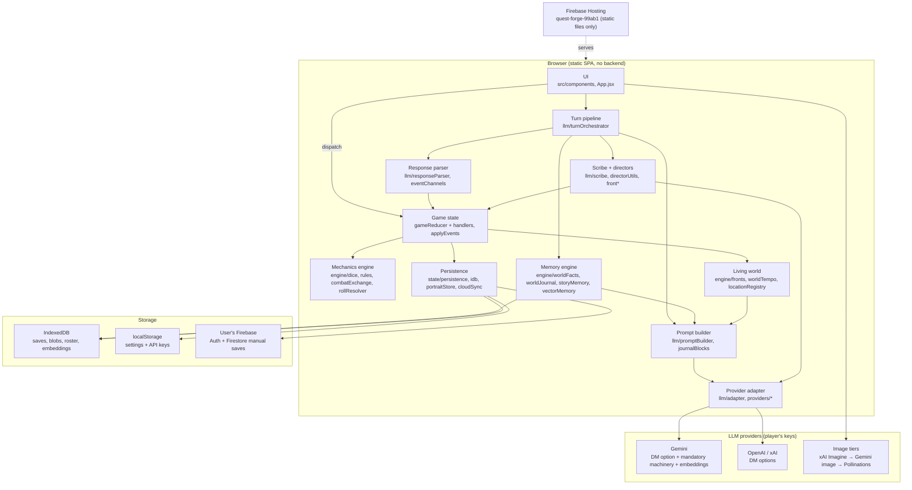

# Quest Forge — Architecture

A map of the country, not an atlas of its states. This file answers "where is the thing
that does X?" and "what does this thing do?" for an agent or a human arriving cold. It names
files and functions but does not link them (links rot). It skips numbers and dates that
churn; those live in `CLAUDE.md`, `docs/DECISIONS.md` and the code itself.

- The *why* and *for whom*: `docs/PRODUCT.md`.
- Settled design calls and their reasons: `docs/DECISIONS.md` (newest first).
- What is in flight: `docs/STATUS.md`. Backlog: `docs/IDEAS.md`.
- Step-by-step flows with sequence diagrams: `docs/flows/`.
- The narrative-memory design note behind the memory tiers: `docs/LLM_WOW_LAYER.md`.
- Human-readable rendering of every diagram in this map: `docs/map.html`.

## Bird's-eye view

- **A single-player tabletop RPG in the browser where an LLM plays Dungeon Master.** React 19 +
  Vite, almost all plain JavaScript. No server of its own: the browser calls Gemini, OpenAI or
  xAI directly with the player's own keys and is deployed as static files on Firebase Hosting.
- **The engine owns truth; the LLM owns feeling.** Every die is rolled client-side with
  `crypto.getRandomValues`; HP, XP, AC, inventory, quests and combat live in one reducer. The DM
  streams prose plus a trailing JSON event block that *declares* what happened; the engine
  validates, clamps and applies it. The DM never rolls and never does math.
- **One turn is one pipeline.** Player text → memory retrieval → system prompt (a byte-stable
  cached prefix + live state) → provider stream → parse → detectors → `applyEvents` → reducer →
  a background Scribe pass that extracts durable memory. Combat swaps the free-form event block
  for a bounded `combat_exchange` intent that the engine resolves atomically.
- **Memory is layered so long campaigns fit the token budget and feel remembered.** World facts,
  a journal summarizing pruned chat, story-memory callback cards, NPC dossiers, hero tells, and a
  Gemini-embedded vector store. The engine judges every write (dedupe, supersession, dormancy,
  retraction); the LLM only proposes.
- **A hidden living world.** Private campaign "fronts" with clocks the player and the DM never
  see as a dossier; the engine leaks only symptoms, rumor, and one permission card per scene.
  Background "directors" (one-shot LLM calls keyed on `session.pending*` markers) grow it.

## Container diagram

## Codemap

### `src/main.jsx`, `src/App.jsx`, `src/components/`

The React shell. `App` chooses between the start screen (`StartScreen`: Continue, load a local
or cloud save, New Game), character creation (`CharacterSheet/CharacterCreation.jsx`) and the
in-game `Layout/AppShell.jsx`, which is remounted on every load (keyed by session id + load
nonce). Panels are one folder each: Chat, Combat, CharacterSheet, Inventory, Quests, Journal
(auto-journal, Chronicle saga view, Places gazetteer), Companions, DiceRoller, SceneArt,
Settings, Debug (the Memory Inspector), AmbientAudio (user-supplied MP3 only).

`Chat/ChatPanel.jsx` is the orchestrator's host, not its brain: `submitPlayerMessage` picks a
lane and calls the turn runner; React effects drive the combat plan/narration cycle, the
one-time campaign opening, the background directors (`BACKGROUND_DIRECTORS`), and the
embedding seed on mount. Pure helpers next to it — `eventRouting.js` (`routeTurnEvents`,
`TURN_ROUTES`), `turnVisibility.js` (`buildMessageWindow`), `missingEventsNudge.js`,
`sessionPriming.js`, `returnCard.js`, `endingCard.js`, `checkOdds.js` — are the testable half.
The return card and the ending card are UI-only artifacts: never a message, never saved.

### `src/state/`

The single source of truth. `GameContext.jsx` holds one `useReducer`, wires Firebase auth,
autosave and the `?debugState=1` globals. `gameReducer.js` is a short dispatcher over a merged
handler table from `handlers/*.js` (character, combat, companions, economy, fronts, heroTells,
inventory, messages, npcs, quests, resources, session, spellcasting, worldMemory;
`shared.js` holds `upsertNpc`, `appendRollHistory`, the item ladder, and `isStaleCampaignAction`,
which the dispatcher asks first so a campaign-stamped action from a lane that outlived its
campaign lands nowhere). `applyEvents.js` turns the parser's normalized events into
dispatches and owns the suppression rules (setup deferral, combat lockout, same-response
dedupes). `initialState.js` is the state shape.

Persistence: `persistence.js` (settings in localStorage; save slots; `serializeGameState` is
spread-and-strip of `user`/`ui`/`settings`, never a field whitelist), `idb.js` (one
IndexedDB database, stores `saves`, `savePayloads`, `portraits`, `chronicleChapters`,
`characters`, `withDb` as the only open/close site), `portraitStore.js` (`BLOB_LANES`:
content-addressed portrait and chapter bytes swapped for refs on save, restored on load),
`cloudSync.js` (the Firestore twin: `users/{uid}/saves/{slotId}` metadata + a `chunks`
subcollection, same lane table, one `{ ok, reason }` result shape), `rosterStore.js` (heroes,
not campaigns), `migrations.js` (`migrateLoadedSave`: unconditional heals, then versioned
steps), `autosavePolicy.js` + `autosaveRuntime.js` (two debounce lanes, an action flush that
waits for the action's own re-render before falling back to a reducer replay),
`settingsSchema.js` (`sanitizeSettings`, the typed settings boundary), `auth.js`.

### `src/llm/turnOrchestrator.js`

The DM-turn pipeline, DOM-free so it is testable: `createTurnRunner` returns `sendToLLM`,
`stageRoleplayCheck`, `acceptRoleplayCheck` / `challengeRoleplayCheck` /
`changeRoleplayApproach`, `sendRollCorrection`, `runPostTurnExtraction`, `runAutoSummarize`.
Every DM call names a row of `DM_LANES` (`standard`, `opening`, `tableTalk`, `combatIntent`,
`combatNarration`, `narration`) whose columns say which prompt projection, response mode,
detectors and nudge apply and whether events are discarded. A call reads ONE captured state;
every dispatch of the turn is recorded and replayed through the pure reducer into
`lastCommittedTurn.stateAfter`, the state the Scribe then reads. `MESSAGE_WINDOW` is the raw
rows the DM ever sees. See `docs/flows/player-turn.md`.

### `src/llm/promptBuilder.js`, `src/llm/journalBlocks.js`

`buildSystemPromptParts` assembles named blocks; `buildSystemPromptSplit` cuts them at
`PREFIX_END_PART` into a byte-stable prefix (rules, format contract, item catalog, the tone
preset and the custom DM instructions, premise, hero identity, spellbook, hero sheet —
nothing live is interpolated there) and a dynamic half (character
status, inventory, quests, world facts, retrieved memories, callbacks, the living-world
blocks, combat). `journalBlocks.js` renders the place line, SESSION HISTORY, LOCATION
TRANSITION HISTORY and KNOWN NPCs, each with its own ceiling. `RESPONSE_FORMAT` is the DM's
JSON contract; `RESPONSE_MODES` are the per-lane tails. `promptBlocks.size.test.js` pins each
dynamic block's ceiling and the prefix's stability; `cacheBoundary.test.js` pins the split.

### `src/llm/responseParser.js`, `src/llm/eventChannels.js`, `src/llm/utils/jsonExtractor.js`

`parseResponse` splits prose from the trailing fenced JSON block (`findFencedJsonBlocks` is the
one fence grammar), repairs truncated JSON, keeps prose on both sides of the block, and
carries the prose-roll and pre-narrated-outcome detectors. `eventChannels.js` is the
registry: every DM channel declared once with its normalizer (`EVENT_CHANNELS`,
`KNOWN_WIRE_KEYS`, `normalizeEvents`); a test fails if the registry and the prompt's format
example drift. `jsonExtractor.js` is the extract → parse → repair walk every LLM-JSON reader
shares. `turnFlags.js` is the one bag of orchestration flags on an events object.

### `src/llm/adapter.js`, `src/llm/providers/`, `src/llm/machinery.js`, `src/llm/modelCatalog.js`

`sendMessage` and `streamMessage` route to `providers/gemini.js`, `openai.js`, `xai.js` (the
last two are instances of `openaiCompatible.js`), with per-attempt stall guards, bounded
retries that honor Retry-After, and a stream that retries only before its first byte.
`providers/sse.js` is the shared transport vocabulary (SSE reader, transient-status
classifier, error shaping). `machinery.js` is the mandatory Gemini lane every background job
runs on regardless of the DM provider (`getBackgroundConfig`, `getPreCommitConfig`,
`dmCallConfig`, `getMachineryGeminiKey`, `isMachineryReady`). `modelCatalog.js` is the picker
catalog. `providers/imageGen.js` is the image tier chain and cache behind `requestPortrait`.

### `src/llm/scribe.js`, `src/llm/scribeAudits.js`, the directors

The Scribe is a silent Gemini-Flash pass after each turn (`runScribe` over
`buildScribeContext`) that extracts world facts, NPC dossier updates, story cards, hero
tells, appearance and gender, and runs the observation-only loot / payment / cast audits
(`scribeAudits.js`). On the journal cadence it also runs the NPC/front reflection
(`runNpcFrontReflection`). The directors — `frontDirector.js`, `frontAftermath.js`,
`frontDoom.js`, `frontUpgrade.js`, `regionalFronts.js`, `absenceDrift.js`,
`wonderDirector.js`, plus `chronicler.js`, `sceneDirector.js`, `npcEnrichment.js`,
`premiseDrafter.js` — share `directorUtils.js` (`runDirector`, `isDirectorReady`,
`parseDirectorJson`) and the give-up registry `engine/directorRetry.js`. Other prompt-side
modules: `tableTalk.js` (OOC detection re-exported from the engine), `recallIntent.js`,
`narrativeMessages.js` (which rows count as story), `combatNarration.js` and
`engineNarration.js` (the engine's own narration prompts), `nameGuidance.js`.

### `src/engine/` — mechanics

Pure and dice-owning: `dice.ts` (the only TypeScript; crypto dice, bounded notation),
`rules.js` (5e math, one modifier ladder `resolvePlayerRollModifier`, conditions,
`describeCheckOdds`), `combatMath.js` (the attack/damage kernel shared by combat and the
out-of-combat resolver), `combatExchange.js` (`planCombatExchange`: validate intent, roll
every die, seal one plan) with `combatWire.js` (the DM's envelope, normalized),
`combatPredicates.js` (phases, who can act), `fightTally.js` (cost, wound card, fight
memories), `rollResolver.js` (`handleRequestedRolls` outside combat), `roleplayCheck.js`
and `outOfCombatRollPolicy.js` (the check proposal and its arbiter), `progression.js`,
`spellcasting.js`, `equipment.js`, `enemyStats.js`, `deathSaves.js`, `companionGear.js`,
`characterUtils.js`, `characterVault.js` (hero export/import, `toHeroTemplate`),
`appearanceIdentity.js` + `castMember.js` (what a painter is told), `portraitUrl.js`.

### `src/engine/` — memory

`worldFacts.js` (`planWorldFactAdditions`: dedupe, negation flips as supersession, state and
intent aspects, `liveWorldFacts` for every present-tense reader), `worldJournal.js`
(`maybeAutoSummarize`: the cadence that summarizes pruned chat, keeps a tail, commits in
order and runs the reflection), `journalEntry.js`, `storyMemory.js` (`curateStoryMemory`,
`findStoryMemoryMatch`, `detectCallbackPayoff`, dormancy), `vectorMemory.js` (the RAG store:
`seedMemories`, `retrieveRelevant`, `queueMemoryItem` / `flushMemoryQueue`, one row composer
per category, a campaign-keyed IndexedDB embedding cache), `textMatch.js` (the shared fuzzy
tokenizer and presence tokenizer), `retraction.js` (what a deleted message takes with it),
`recallDossier.js` (the zero-LLM record a "remember when…" question is answered from),
`commitmentVerifier.js`, `npcRoster.js` (dossier merges, `resolveNpcRef`, impressions, bond
moments; `upsertNpc` itself lives in `state/handlers/shared.js`), `relationshipArc.js`
(`deriveRelationshipStage` / `deriveRelationshipArc`: where the bond stands and how it got there,
derived from the bond moments on every read, never stored), `heroTells.js`. See `docs/flows/memory-system.md`.

### `src/engine/` — living world

`fronts.js` (hidden clocks: `normalizeFrontProposal`, `applyFrontAdvanceBatch`,
`openDoomWindow`, `describeFrontReveal`), `worldTempo.js` (`buildWorldTempoBlock`: pace vs
measured heat, one permission or doom card, the encounter ledger), `worldMotifs.js`,
`locationRegistry.js` (canonical places, theaters, travel links, `listVisitedPlaces`),
`regionProfile.js`, `regionalHearsay.js`, `interlude.js`, `wonder.js`, `heroDeath.js`,
`livingWorldSession.js` (load sanitizers for the one-shot markers), `directorRetry.js`.
Shelves used everywhere: `text.js` (type-strict `cleanText`, flags), `replayLedger.js`
(pipe-string ledgers, conversational distance), `currency.js`. See
`docs/flows/hidden-fronts.md`.

### `src/data/`, `src/config/`, `src/debug/`, `src/dev/`

`data/`: the trimmed content set — 4 races, 4 classes, items, spells, presets, premise
starters. `config/contentLimits.js`: the shared clamp constants every boundary reads;
`config/firebase.js`: the lazily loaded, user-supplied Firebase SDK. `debug/`: the
flag-gated Memory Inspector store. `dev/`: dev-only seeders; a production import of `dev/`
fails lint.

### `scripts/`, `docs/`

`scripts/*.mjs` are real-provider evals; `scripts/*.cjs` are Puppeteer playtests against the
dev server or the production preview (`playtest_opus_driver.cjs` lets an outside agent play
turn by turn). `check-dist-preload.mjs` fails the build if the Firebase chunk is preloaded;
`build-docs-map.mjs` regenerates `docs/map.html` from this file and `docs/flows/`. `docs/`
holds the live queues (`STATUS`, `IDEAS`, `DECISIONS`, the three scheduled-audit files),
dated eval and playtest reports, and `agent-dialogues/`.

## Architectural invariants

- **The LLM never rolls and never mutates state.** Dice come only from `dice.ts`; a requested
  roll's `modifier` is ignored for the hero; `applyEvents` drops every non-exchange event while
  combat is active; `handleRequestedRolls` refuses to run in combat.
- **The engine is the single source of truth; the prompt describes it.** If the DM "should" do
  math, the client already does it. A feature is a JSON field → a normalizer in
  `eventChannels.js` → a reducer action → a prompt line saying the field exists.
- **Every DM-writable mechanical channel ships with a replay ledger** (coin, purchases, sales,
  spells, rests, XP, item grants; combat uses `exchangeId`). The DM re-emitting an applied event
  on a later turn is a proven failure mode. Windows are measured in conversational distance.
- **Every LLM lane is a trust boundary.** A reducer fed by any lane projects the payload to known
  keys and clamps every text it stores; engine-owned stamps can never arrive from a lane.
- **The prompt prefix is byte-stable.** Live state never enters a prefix block; the response
  mode is the tail. Tests pin the split and each dynamic block's ceiling.
- **Persistence is by construction.** `serializeGameState` strips three fields and keeps the
  rest; autosave fires on any persisted-field change; a new state field needs no wiring.
  Settings and API keys are device-local and never in a save.
- **Resolved is terminal** for story cards and for fronts. `LOAD_GAME` keeps the live user and
  the device's settings; Continue never calls the DM.
- **Fronts are private.** The player never sees them; the DM sees id and faction stubs and at
  most one permission or doom card per scene. Resolution is the one moment a title is revealed.
- **The world's timing is dice, its content is directors.** Arc reasoning (an LLM) decides what
  and where; a crypto die decides when; the reducer re-validates every install.
- **Records are frank in content, clinical in register.** Durable text is written in neutral
  vocabulary at full specificity; nothing established is quietly tidied away.

### Deliberate absences

No backend or hosted keys (the hosted Firebase project serves static files only; cloud saves
are bring-your-own Firebase). No multiplayer. No battlemaps, coordinates or DM-declared
distances (travel is edges between named places). No procedural or automatic audio. No
TypeScript beyond the dice engine and no CI type-check. No feats, no concentration mechanic,
no classes or races beyond the trimmed four and four. No visible fronts dossier for the DM.
No regex fallback for the loot audit (if the Scribe is down, the audit skips). No ceiling on
the story-card pool and no reducer-side portrait cap (decided; the Inspector makes the
numbers visible). No field whitelist in serialization, ever again.

## Layer and system boundaries

- **UI → state** only through `dispatch`; the UI never mutates state and never computes
  mechanics. **UI → turn pipeline** through the runner's named entry points.
- **`state/handlers/` import nothing from `llm/`** (the OOC detector lives in
  `engine/tableTalkIntent.js` for this reason). `state/` reaches `llm/` only for the model
  catalog.
- **`engine/` is mostly pure.** Three engine modules make network calls — `worldJournal.js`
  (the cadence), `vectorMemory.js` (embeddings), `outOfCombatRollPolicy.js` (the arbiter) —
  and a handful import pure helpers from `llm/`. Nothing in `engine/` imports from
  `components/`.
- **A wart worth knowing:** `llm/turnOrchestrator.js` imports three pure helpers from
  `components/Chat/` (`turnVisibility.js`, `eventRouting.js`, `missingEventsNudge.js`). They
  are DOM-free and belong on the `llm/` side; the dependency arrow points the wrong way.
- **Provider boundary:** only `llm/adapter.js` and `llm/providers/` know HTTP. Everything else
  receives `sendMessage` / `streamMessage` or a config object from `machinery.js`.
- **Storage boundary:** only `state/persistence.js`, `idb.js`, `portraitStore.js`,
  `rosterStore.js`, `cloudSync.js` and `engine/vectorMemory.js` read or write IndexedDB or
  Firestore; `config/firebase.js` only loads the SDK.
- **The campaign boundary** is `session.id` + `session.loadNonce`: long-running lanes stamp
  their writes (`campaignStamp`) and the dispatcher drops a stale one.

## Cross-cutting concerns

- **Configuration.** Device settings (provider, model, keys, pace dial, custom DM prompt,
  Firebase config) live in localStorage behind `sanitizeSettings`. Shared clamp constants
  live in `config/contentLimits.js`. There is no `.env` for the app; evals may read one.
- **Secrets.** Three keys: the DM key for the chosen provider, the mandatory Gemini machinery
  key (the DM key doubles when the DM is Gemini), and the xAI image key. All three are typed
  settings fields, stripped from saves and from the debug snapshot. Hosting's CSP names the
  provider origins the browser may call.
- **Error handling.** A refusal, a prompt block or an empty reply is an error, never a blank
  turn. Infrastructure failures post `kind: 'error'` system lines that no story reader (journal,
  chronicler, RAG) ever ingests. Cloud calls return `{ ok, reason, message }`; nothing throws
  across the UI boundary. Directors give up after a fixed number of failures and install an
  empty result so a stuck marker cannot block its lane.
- **Observability.** No remote telemetry. The Memory Inspector (`settings.memoryInspector` or
  `?debugMemory=1`) shows retrieval, injection, cache share and the record dossier;
  `?debugState=1` exposes state, dispatch and the inspector on `window` for harnesses.
- **Testing.** Vitest, co-located `*.test.js`, Node environment, run before every commit that
  touches engine or parser. Golden fixtures for parser quirks; pinning tests for prompt
  ceilings, lane behavior, the event registry, cache boundary, modifier parity and the save
  lanes. Real-provider evals and Puppeteer playtests live in `scripts/` and need keys.
- **Deployment.** Static files on Firebase Hosting: `/` and `/index.html` no-store,
  `/assets/**` immutable. Commands and the master-only workflow: `CLAUDE.md`.
