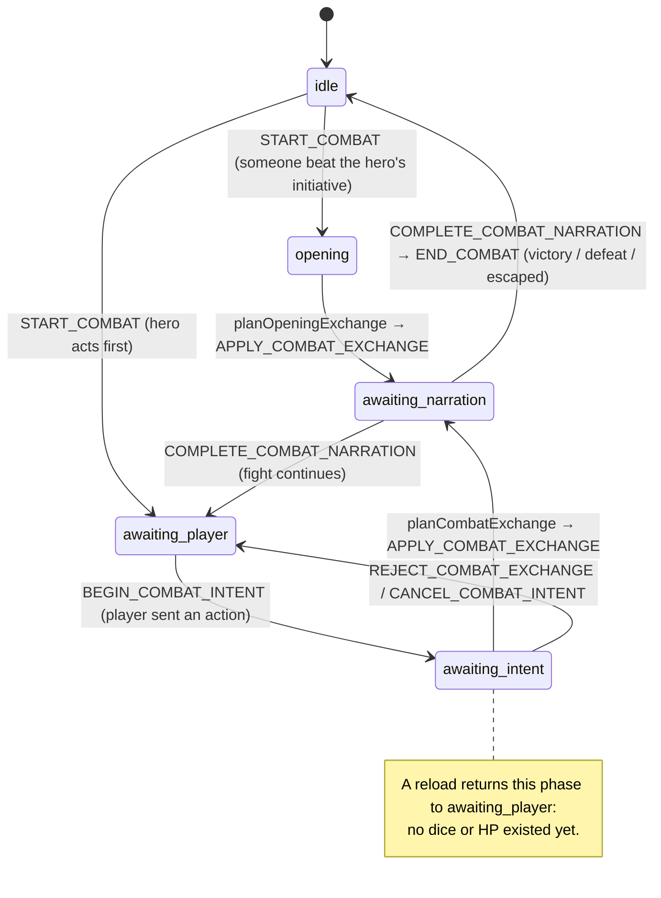
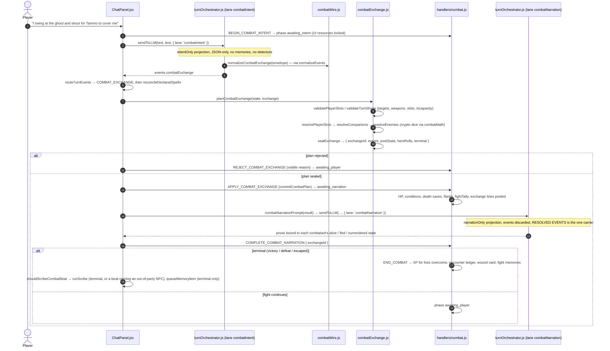

# Flow: a combat round

Active combat never uses the free-form roll path. The DM emits a bounded `combat_exchange`
intent; `engine/combatExchange.js` validates it against live state, rolls every die, and seals
one plan; the reducer commits it atomically by `exchangeId`; a separate narration-only call
reads the stored result and cannot change it. Phases are `COMBAT_PHASES` in
`engine/combatPredicates.js`.

## Phase machine

## One round, end to end

## Notes

- **Opening initiative.** `START_COMBAT` (from a `combat_start` event through `applyEvents`)
  rolls initiative for everyone. Actors who beat the hero get one engine-owned opening slot;
  the ChatPanel effect plans it with `planOpeningExchange` and commits it like any exchange.
  The player action that started the fight is queued behind the opening, never dropped.
- **Intent, not authority.** The DM declares `player_slots`, companion intent (attack, defend,
  guard, pass) and enemy intent (attack, defend, flee, surrender). It supplies no dice and no
  HP. Invalid player targets reject the whole plan; an invalid NPC target drops only that
  actor's slot and never silently retargets.
- **Order is live.** Player → companions → active enemies, read from state at resolution time,
  so a foe overcome before its slot cannot act. A natural-20 death save revives before the
  enemy phase.
- **Idempotent narration.** The stored result carries an authoritative post-exchange snapshot
  of hero, companions and enemies; a narration retry or a reload re-reads it. Completing the
  narration IS the exit even when the narration call throws (a visible line is posted).
- **Terminal judgement.** `terminalState` in combatExchange.js decides victory, defeat or
  escape from the field (who stands, who fled, whether the hero can act). A hero at zero HP
  with no battle-ready companion at low level is a non-lethal setback (`isLowLevelSolo`,
  asked live at every decision point).
- **What the DM reads next round.** The combat block in the prompt is data: enemies with
  health words and conditions, flanks, the hero's status line (dying, stable, incapacitated),
  the cost tally on the terminal call only. The narration lane's prompt tells the DM to end on
  each foe's telegraphed next move; the next intent call is asked to honor it.
- **Spellcasting rides the same machine.** `cast` slots resolve through the exchange (attack
  spells vs AC, darts, shared-pool saves with per-target engine saves, support spells on the
  party). Out of combat, `spell_cast` events go through `CAST_SPELL` with a replay ledger.
- **What never happens in combat:** `requested_rolls` (rejected), rests (rejected), DM events
  other than the exchange (dropped by `applyEvents`), the Scribe on a non-terminal beat that
  names nobody outside the party.
