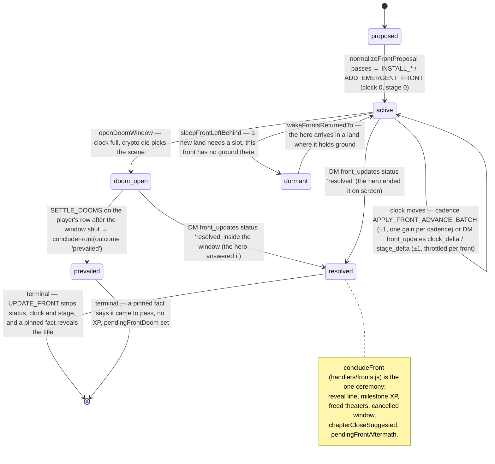
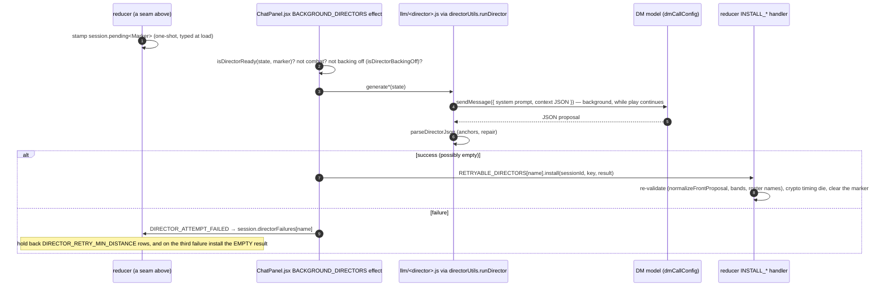

# Flow: hidden fronts and the living world

A front is a private campaign clock: a faction or force, a goal, a clock from 0 to full,
derived portent stages, and authored portents. The player never sees one. The DM never sees
one as a dossier either: it reads id-and-faction stubs, one permission card (or one doom card)
per scene, and in-world symptoms. The engine owns every number and every timing die; LLM
directors only propose content, and each reducer installer re-validates it.

## Front lifecycle

## Where the world moves: engine seams and what they mint

| Seam (reducer action) | Mints |
|---|---|
| `SET_LOCATION` arriving at a different canonical place | travel edge (`linkLocations`); `wakeFrontsReturnedTo`; regional seed marker (`pendingRegionalFronts`) or a deferred land; the establishing-shot interlude (`openRegionInterlude`); traveling rumor (`selectRegionalHearsay` → `session.regionalHearsay`); the absence-drift marker after a long time away |
| `UPDATE_LOCATION_PROFILE` (the Scribe's place classification) | motif tally; region face request; sleep-to-make-room / wake; deferred regions |
| `ADD_JOURNAL_ENTRY` (the cadence) | `rollRelationshipBeat`, `rollHeroTellBeat`, `rollWonderRequest` (`pendingWonder`); story-card dormancy |
| the cadence reflection (from `scribe.js`) | `APPLY_TEMPO_DIRECTIVE` (which front may surface, where, how loud), `APPLY_FRONT_ADVANCE_BATCH`, at most one `ADD_EMERGENT_FRONT` |
| `END_COMBAT` | encounter ledger (`appendRecentEncounter`), motif families, fight memories and the wound card, hearsay window |
| `UPDATE_NPC` | `detectBondTurn` → `mintTurnBeat` (a bond turning into a scene) |
| `ADD_MESSAGE` | a player row settles an expired doom (`SETTLE_DOOMS`); a narrative DM row spends an open interlude (`consumeInterlude`) |
| either clock lane | `openDoomWindow` when a clock is full; `detectFrontTurning` → an interlude on a stage crossing |

## The director pattern

| Director | Marker | Install | Empty result |
|---|---|---|---|
| campaign fronts (`frontDirector.js`) | none — keyed on a fresh session id | `INSTALL_GENERATED_FRONTS` | not retried; the deterministic fallback front stays |
| front aftermath (`frontAftermath.js`) | `pendingFrontAftermath` | `INSTALL_AFTERMATH_FRONTS` | `[]` (a clean victory) |
| front doom (`frontDoom.js`) | `pendingFrontDoom` | `INSTALL_DOOM_AFTERMATH` | `{}` |
| absence drift (`absenceDrift.js`) | `pendingAbsenceDrift` | `INSTALL_ABSENCE_DRIFT` | `{}` (nothing changed) |
| regional fronts (`regionalFronts.js`) | `pendingRegionalFronts` | `INSTALL_REGIONAL_FRONTS` | `{ fronts: [], profile: null }` |
| wonder (`wonderDirector.js`) | `pendingWonder` | `INSTALL_WONDER` | `[]` |
| v2 upgrade (`frontUpgrade.js`) | player-triggered from Settings | `UPGRADE_FRONTS_V2` | n/a |

## What reaches the DM, and what it may write back

Private blocks in the dynamic half of the prompt (never on the intent or nudge projections,
never in combat unless noted):

| Block | Builder |
|---|---|
| `## WORLD TEMPO — PRIVATE PACING STATE` — pace dial vs measured heat, front stubs, ONE permission card or the doom card, victory / came-to-pass echoes, recent fights, worn motifs | `buildWorldTempoBlock` (engine/worldTempo.js) |
| `## REGIONAL HEARSAY — PRIVATE` | `buildRegionalHearsayBlock` |
| `## WHILE YOU WERE AWAY — PRIVATE` | `buildWhileYouWereAwayBlock` (llm/absenceDrift.js) |
| `## SOMETHING STRANGE ARRIVES — PRIVATE` | `buildWonderBlock` |
| `## SOMEONE REACHES OUT` / `## THE BOND HAS TURNED` | `buildRelationshipBeatBlock` |
| `## WHAT THEY HAVE NOTICED ABOUT THE HERO` and the two hero-tell beat headers | `buildHeroTellsBlock`, `buildHeroTellBeatBlock` |
| `## AN INTERLUDE — THE WORLD TURNS (PRIVATE)` | `buildInterludeBlock` |
| `## RECENT TABLE RULINGS — BINDING` | `buildRecentRulingsBlock` |

The DM's only write channel into this system is `front_updates`: a front `id`, a
`clock_delta` or `stage_delta` of one step (throttled per front and per direction), `status:
"resolved"` and nothing else, `notes`, and appended `publicHints`. Titles the DM emits are
ignored. Hearsay, drift, wonder, beats and interludes have no DM channel at all: the DM voices
them in the fiction or does not.

## Invariants

- Fronts are born at clock 0 and stage 0 through one boundary, `normalizeFrontProposal`,
  shared by every director and every installer (complete-or-nothing).
- One front gains clock per cadence, never the same front twice running; stage never regresses.
- A full clock is a doom: one window at a time, the final portent comes to pass unless the hero
  answers it; the loss line never itemizes what the player missed.
- Nobody dies off-screen: absence drift and doom aftermath may touch only existing roster
  NPCs' agenda and notes, and only the one record a name exactly resolves to.
- Every timing is a crypto die (tempo window, doom scene, wonder delay, relationship and
  hero-tell beats); every content proposal is re-validated at install.
- `resolved` is terminal.
