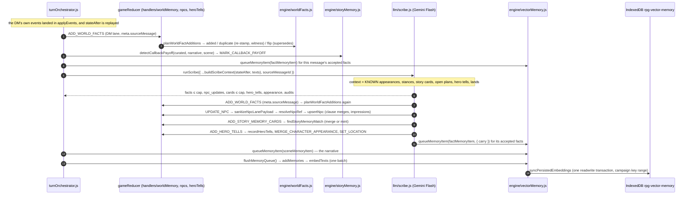
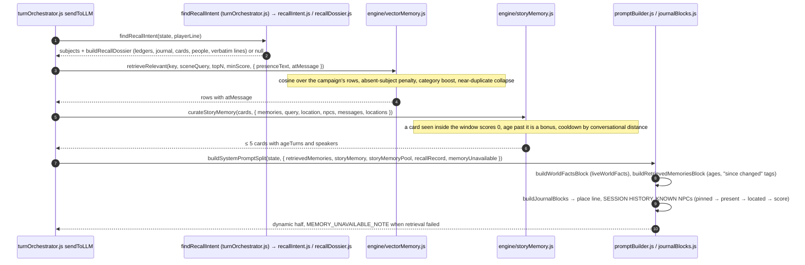
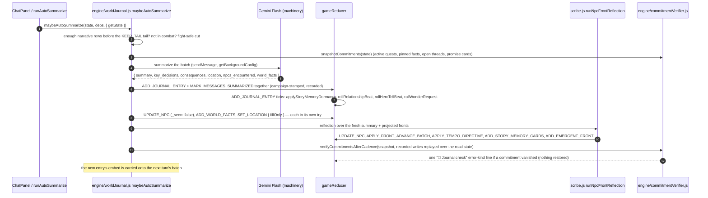

# Flow: the memory system

How campaign memory is written, stored, retrieved and pruned. The DM's raw window is short
(`MESSAGE_WINDOW` rows in `llm/turnOrchestrator.js`); everything older survives only as one
of the tiers below. The engine judges every write; the LLM lanes only propose. Design
rationale: `docs/LLM_WOW_LAYER.md`; settled calls: `docs/DECISIONS.md`; the research
doctrine: `docs/MEMORY_RESEARCH.md`.

## The tiers at a glance

| Tier | State field | Written by | Read into the prompt as | Retired by |
|---|---|---|---|---|
| World facts | `worldFacts` | DM `world_facts` events, the Scribe, the journal cadence, engine (front resolution) — all through `planWorldFactAdditions` | `## WORLD FACTS` (pinned first, newest next; state/intent facts tagged with age) | supersession (a negation flip), retraction; never deleted |
| Journal | `journal` | `maybeAutoSummarize` → `ADD_JOURNAL_ENTRY` | `## SESSION HISTORY`, LOCATION TRANSITION HISTORY, the place line (`journalBlocks.js`) | never; the summarized chat rows leave the window via `MARK_MESSAGES_SUMMARIZED` |
| Story-memory cards | `storyMemory` | Scribe and reflection (`ADD_STORY_MEMORY_CARDS`), engine (fight wound card, `MARK_CALLBACK_PAYOFF`), DM `memory_updates` (status/salience only) | `## DRAMATIC CALLBACK OPPORTUNITIES` via `curateStoryMemory` | `applyStoryMemoryDormancy` on the cadence, callback cooldown, retraction → dormant; `resolved` is terminal |
| NPC roster | `npcs` | every lane through `UPDATE_NPC` → `upsertNpc` (`state/handlers/shared.js`), merges in `engine/npcRoster.js` | `## KNOWN NPCs` (presence-first), the party line, an `npc` vector row | archive, impression TTL, bond-moment cap, retraction drops impressions |
| Hero tells | `heroTells` | the Scribe's `ADD_HERO_TELLS` → `recordHeroTells` | `## WHAT THEY HAVE NOTICED ABOUT THE HERO` + beat blocks | fade after long silence; the player's "That's not me" strike (`SET_HERO_TELL_DORMANT`) |
| Vectors (RAG) | not in the save: in-memory `memoryStore` + IndexedDB `rpg-vector-memory` / store `embeddings`, keyed `[sessionId, text]` | `seedMemories` on mount; `queueMemoryItem` + `flushMemoryQueue` after a turn; `addMemories` for the player line | `## RETRIEVED MEMORIES` via `retrieveRelevant` → `buildRetrievedMemoriesBlock` | transient-row eviction at the campaign cap, branch pruning on seed, `retractMemoriesFromMessage` |

Gemini-only: embeddings use `gemini-embedding-2` through the mandatory machinery key, which
is why play refuses to start without it.

## Write path: after a turn

- **Source stamps.** Every Scribe dispatch carries `meta.sourceMessage`; the reducer stamps
  facts and cards at birth. Deleting that message (`DELETE_MESSAGE`) runs `planRetraction`
  (`engine/retraction.js`): a fact or card is retracted only when no later witness restated
  it; ChatPanel then calls `retractMemoriesFromMessage` so the vector rows leave too.
- **One composer per category.** `factMemoryItem`, `sceneMemoryItem`, `journalMemoryItem`,
  `npcMemoryItem`, `storyCardMemoryItem` build every row the seed, the live lanes and the
  retraction touch, so a row's text is its identity and the live text equals the seed's.
- **Trust boundary.** `sanitizeNpcLanePayload`, `normalizeJournalEntry`,
  `stripStoryMemoryEngineStamps` and the fact typing project every lane payload to known keys
  and clamp every text before it is stored.

## Read path: before a turn

## The journal cadence

The cadence fires only once enough narrative-eligible rows lie before the kept tail, so the
DM window is never emptied by a summary. Three consecutive failures write a `fallback` entry
that no RAG lane embeds. Every write below the Flash await is campaign-stamped, so a cadence
in flight when the player loads another save lands nothing.

## Pruning, in one place

- **Window:** `MARK_MESSAGES_SUMMARIZED` flags rows; `buildMessageWindow` skips them. Rows
  are never deleted; soft-delete (`deleted: true`) keeps indexes stable.
- **Facts:** a near-duplicate is dropped (a passing-state or intent fact re-stamps its age
  instead); a negation flip supersedes its twin; `liveWorldFacts` filters superseded and
  retracted facts for every present-tense reader while the record keeps them.
- **Cards:** low-salience cards go dormant after a few untouched cadences, engine wound cards
  after more; `resolved` never revives except by an explicit DM status update.
- **NPCs:** impressions expire; bond moments evict lowest-salience first; descriptive labels
  and fodder are archived, never deleted.
- **Vectors:** the campaign cap evicts only `player` / `narrative` rows (durable canon never);
  the seed prunes record rows the save no longer carries and transient rows whose source
  message the transcript no longer holds (a load is a branch).
- **Retraction:** `DELETE_MESSAGE` follows the last witness.
