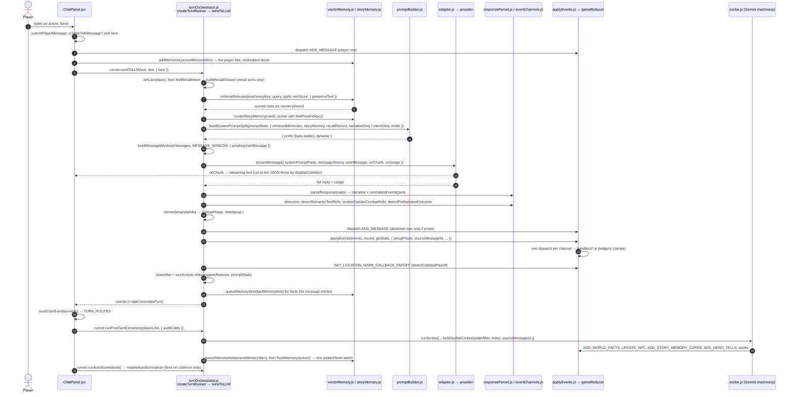
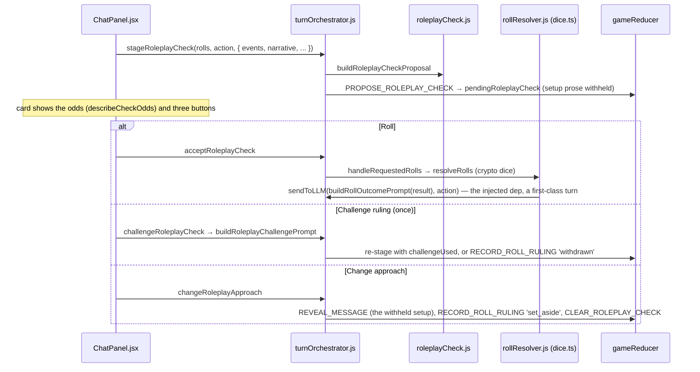

# Flow: one player turn

The ordinary out-of-combat turn on the `standard` lane, end to end. Combat and dice have
their own flows (`combat-round.md`; the roll proposal is covered at the end of this file).
Every participant below is a real module; every arrow is a real call or dispatch. Anything
inferred rather than read is marked "(inferred)".

## Notes on each step

1. **Input.** `ChatPanel.submitPlayerMessage` is the one send path (the composer, the recap
   button and the epilogue button all use it). `isTableTalkMessage` (engine/tableTalkIntent.js)
   routes `OOC:` lines to the `tableTalk` lane; in combat the lane is `combatIntent` and the
   reducer is told with `BEGIN_COMBAT_INTENT`. A dead hero blocks every non-OOC send.
2. **The player row is committed and embedded before the DM is called.** The player line is a
   `player` category vector row, labeled non-canonical for retrieval.
3. **Lane table.** `DM_LANES` in turnOrchestrator.js. The `standard` row wants memories, runs
   detectors and the nudge, keeps events. `tableTalk` discards events. `combatIntent` is
   JSON-only on the `intentOnly` projection and wants no memories.
4. **Recall.** `findRecallIntent` (turnOrchestrator.js, over `detectRecallIntent` from
   llm/recallIntent.js) widens retrieval and builds the zero-LLM record block
   (`engine/recallDossier.js`) for "remember when…" questions. Recall
   turns strip every mechanical channel from the reply (`RECALL_STRIPPED_EVENT_KEYS`).
5. **Retrieval** is presence-aware: `buildPresenceText` (llm/narrativeMessages.js) feeds the
   last narrative rows so a row about an absent person is penalized. A failed query sets
   `memoryDown` and the prompt carries a memory-unavailable note instead of silence.
6. **Prompt.** `buildSystemPromptSplit` returns the prefix and dynamic halves. The prefix
   (rules, format, premise, hero identity, spellbook, hero sheet) is byte-identical across
   turns so provider caching engages; OpenAI-compatible providers receive it as a separate
   leading system message. The dynamic half carries live state and the private living-world
   blocks (see `hidden-fronts.md`).
7. **Window.** `buildMessageWindow` (components/Chat/turnVisibility.js) sends the newest raw
   rows, dropping hidden, deleted and summarized rows, exchange lines, and any unanswered copy
   of the line being sent. Engine receipts stamped `dmVisible` ride it so the DM knows a reward
   was banked.
8. **Stream.** `streamMessage` retries only before the first byte; an idle stall aborts with a
   message; a refusal or prompt block throws. Usage (cached tokens) is captured for the
   Memory Inspector.
9. **Parse.** `parseResponse` separates prose from the fenced block, repairs truncated JSON and
   keeps prose on both sides. `normalizeEvents` walks the `EVENT_CHANNELS` registry; an
   unreadable block posts a system line, an empty reply throws.
10. **Detectors** (standard/opening lanes only): a roll narrated in prose becomes a proposal; a
    check the arbiter rejects routes to a correction call; an outcome narrated before a roll is
    flagged so the setup is withheld.
11. **Commit.** The assistant row is committed only when there is prose. `applyEvents` dispatches
    through `record`, which also pushes to `turnActions`; in a setup phase (a pending roll) it
    defers outcome channels. Each handler clamps and consults its replay ledger.
12. **State after.** `turnActions.reduce(gameReducer, promptState)` is the state the turn LEFT,
    independent of React's render lag. It is what the Scribe reads.
13. **Routing.** `routeTurnEvents` tells ChatPanel whether the turn ended, staged a roll
    proposal, started combat, or needs a correction. Only a finished turn runs extraction.
14. **Scribe.** One Gemini-Flash call extracts facts, NPC updates, cards, tells and runs the
    loot/payment/cast audits. Its facts are queued with `carry` and ride the next flush.
15. **Embed.** `flushMemoryQueue` sends the turn's facts and the narrative as ONE embed batch
    and persists the rows to the campaign's IndexedDB key range.
16. **Cadence.** `maybeAutoSummarize` fires only when enough narrative rows lie before the kept
    tail; see `memory-system.md`.

## The roll proposal branch

When the DM's events carry `requested_rolls` outside combat, nothing is rolled yet:

Rulings that end without dice persist in `recentRulings` and render as a binding prompt block
on later turns. A hero who cannot act skips the check with a visible line (the actor gate in
`engine/combatPredicates.js`).
