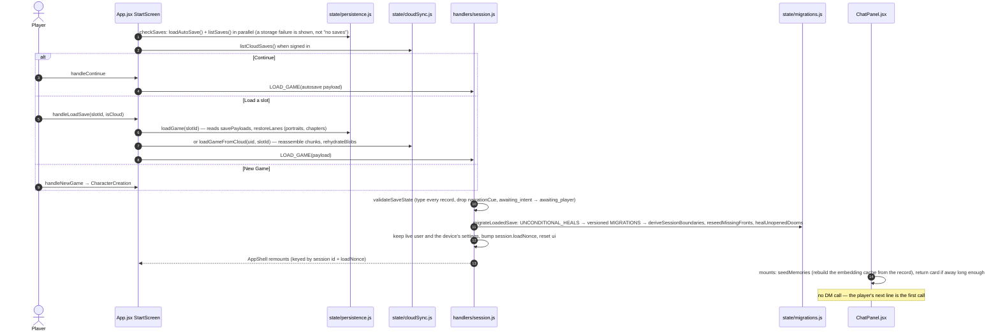
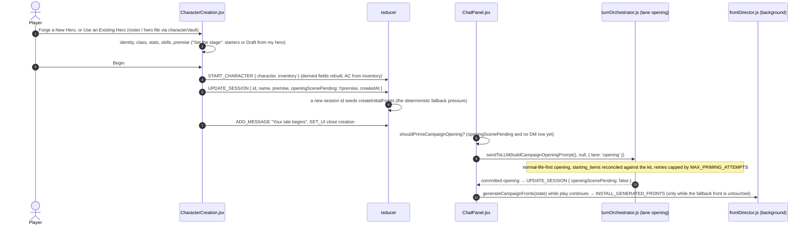
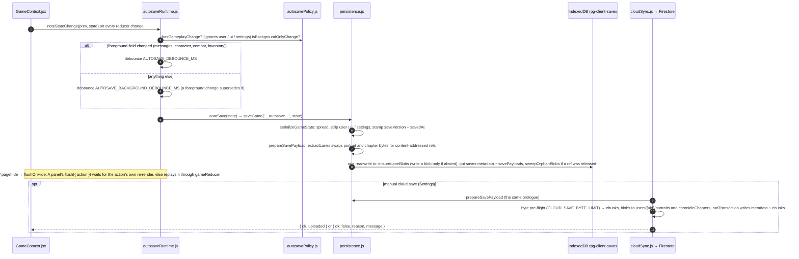

# Flow: session lifecycle — start, continue, load, new campaign, save

Where a campaign comes from and where it goes. One rule shapes all of it: Continue and Load
restore the exact conversational handoff and never call the DM; only a fresh campaign with a
premise triggers one automatic DM call, the opening scene.

## Start screen

## New campaign

A hero is not a campaign: the roster (`state/rosterStore.js`) and hero files
(`engine/characterVault.js`, format `quest-forge-character`) carry character + inventory
through `toHeroTemplate`, rested, with derived fields rebuilt on import. A dead hero's
campaign is finished (the ending card), but the hero may begin again from the roster.

## Save

## Storage map

| Where | What |
|---|---|
| localStorage `rpg-client-settings` | device settings incl. the three API keys, through `sanitizeSettings` |
| localStorage `qf-return-card-dismissed:<sessionId>` | return-card dismissal |
| IndexedDB `rpg-client-saves` → `saves` | slot metadata (projected by `projectSaveMetadata`), `portraitRefs`, `chapterRefs` |
| → `savePayloads` | the slim state per slot (`__autosave__` included) |
| → `portraits`, `chronicleChapters` | content-addressed blobs (`BLOB_LANES`) |
| → `characters` | the hero roster |
| IndexedDB `rpg-vector-memory` → `embeddings` | the RAG cache, keyed `[sessionId, text]`; rebuildable from the save |
| Firestore `users/{uid}/saves/{slotId}` + `chunks/{index}` | manual cloud saves (metadata + payload slices) |
| Firestore `users/{uid}/portraits/{key}`, `chronicleChapters/{key}` | the same blob lanes |

Autosave is local only by design (Continue means this device's session); cloud saves are
manual and visible on every signed-in device. The hosted Firebase project
(`quest-forge-99ab1`) serves the static site only; user data goes to the user's own Firebase
config entered in Settings.

## Invariants

- `serializeGameState` has no field whitelist. Autosave fires on any persisted field. A new
  state field persists with zero wiring.
- `LOAD_GAME` keeps the live `user` and the device's `settings`; a save's embedded settings
  (legacy only) are ignored.
- No ref ever reaches live state: `restoreLanes` runs inside `loadGame` and
  `loadGameFromCloud`.
- Long-running writes (chapter close, Deepen memory, portraits, the cadence, the Scribe) are
  campaign-stamped; `isStaleCampaignAction` at the dispatcher drops one whose session id or
  load nonce no longer matches.
- Save promises resolve on the transaction's completion; `withDb` is the one open/close site.
